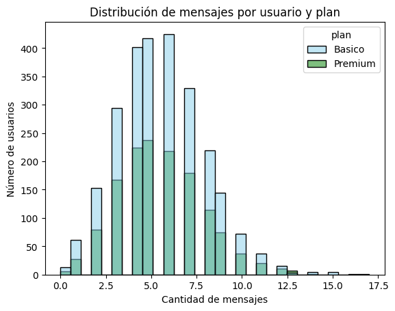
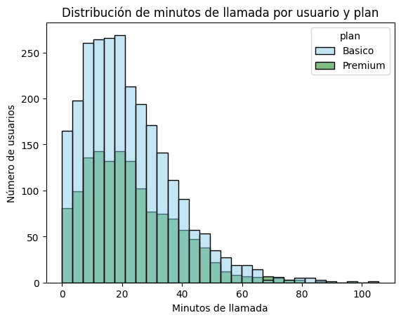
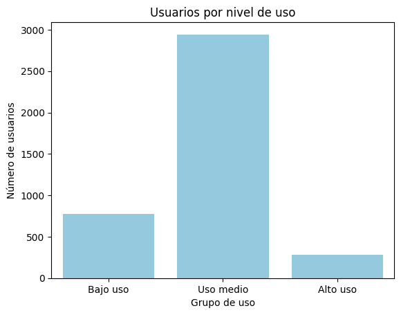
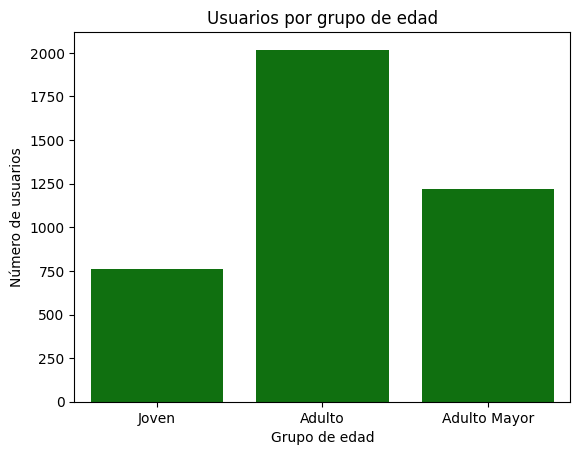

# ConnectaTel Customer Analysis

**TripleTen Data Analyst Bootcamp project (2026) | Python · pandas · Seaborn**

ConnectaTel is a telecom company in Latin America. This project cleans and analyzes data on 4,000 customers and 40,000 calls and text messages from 2024 to build a statistical profile of its users, detect unusual behavior and segment customers by usage and age, in order to support retention strategies and improvements to the current plans.

## 🎯 Business questions

- How do customers actually use their plans, and does it differ between the Basic and Premium plans?
- Which customer segments exist, and which ones are the most valuable?
- What changes to the plan offering would better fit real customer behavior?

## 🗂️ Data

| Dataset | Content | Size |
| --- | --- | --- |
| `plans.csv` | Current plans: monthly price and included minutes, messages and GB | 2 rows |
| `users_latam.csv` | Customers: age, city, registration date, plan and churn date | 4,000 rows |
| `usage.csv` | Usage events: calls with duration and text messages with length | 40,000 rows |

## 🧹 Data quality issues found and fixed

| Issue | Records | Action |
| --- | --- | --- |
| Age stored as the sentinel `-999` | 55 users (1.4 %) | Replaced with the median age (48) |
| City missing or recorded as `'?'` | 565 users (14.1 %) | Unified as missing values |
| Registration dates in 2026, after the data period | 40 users (1.0 %) | Set as missing dates |
| Placeholder values (120 minutes and 1,490 characters), including 28 events with the metric of the wrong type | 30 events per column | Set as missing, keeping the events |
| Usage events without a date | 50 events (0.1 %) | Kept, since the analysis counts events per user |

The placeholder values were detected because they were always the maximum and were isolated from the rest of the data: after 120 minutes, the longest call lasts 46.98 minutes, and after 1,490 characters, the longest message has 125.

## 🛠️ Process

1. **Exploration:** structure, data types, missing values and summary statistics of the three datasets.
2. **Data quality review:** missing values, sentinel values and out-of-range dates.
3. **Cleaning:** sentinel replacement, date conversion and a check that missing `duration` and `length` values depend on the event type.
4. **Aggregation:** messages, calls and call minutes per user, merged with customer data.
5. **Distributions and outliers:** histograms by plan, boxplots and the IQR method.
6. **Segmentation:** customers grouped by usage level (low, medium, high) and age (young, adult, senior).
7. **Executive summary:** findings and recommendations for the business.

## 📊 Visualizations

  
  

  
  

## 💡 Key findings

1. **Customers use far less than their plans include.** The typical customer made 4 calls, 19.7 minutes of calls and 5 text messages in 2024, compared with the 100 minutes and 100 messages included in the Basic plan.
2. **Premium usage barely differs from Basic.** Premium costs more than twice as much (USD 25 vs. USD 12), but its users send the same number of messages and only call slightly more, which may make them feel they are overpaying.
3. **Most customers are medium users.** About three out of four customers fall in the medium-usage segment, about 19 % in low usage and only about 7 % in high usage.
4. **Age does not drive plan choice.** Adults (30 to 59) are the largest group, and the share of Premium customers is similar across all ages.
5. **Outliers are real heavy users.** After removing the placeholder values, the remaining extreme values (up to 17 messages, 15 calls and 105 minutes) represent the highest-consuming customers and were kept.

## ✅ Recommendations

- Reinforce the value of the Premium plan with benefits customers actually use, or review its price.
- Create a lower-cost entry plan for low-usage customers.
- Focus upselling campaigns on high-usage customers on the Basic plan.
- Analyze churn (11.7 % of customers) by plan and usage segment.
- Improve data capture for city and remove system placeholder values at the source.

**Limitation:** the usage data does not include mobile data (GB), a key component of the plans, so the plan evaluation is based only on calls and messages.

## 📁 Files

| File | Description |
| --- | --- |
| `connectatel_customer_analysis.ipynb` | Full analysis with code, charts and conclusions (in Spanish) |
| `images/` | Charts used in this README |

The datasets were provided by the TripleTen platform and are not included in this repository.

## 🧰 Skills demonstrated

Python · pandas · data cleaning · sentinel and outlier detection (IQR) · missing data analysis (MAR) · data aggregation and merging · customer segmentation · Seaborn and Matplotlib · data storytelling
